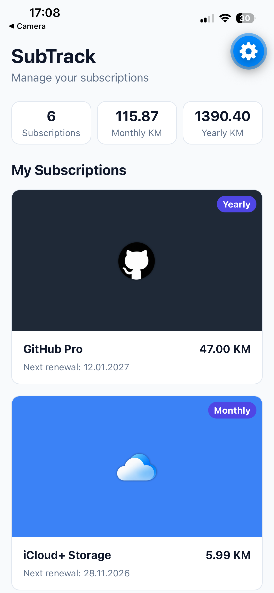
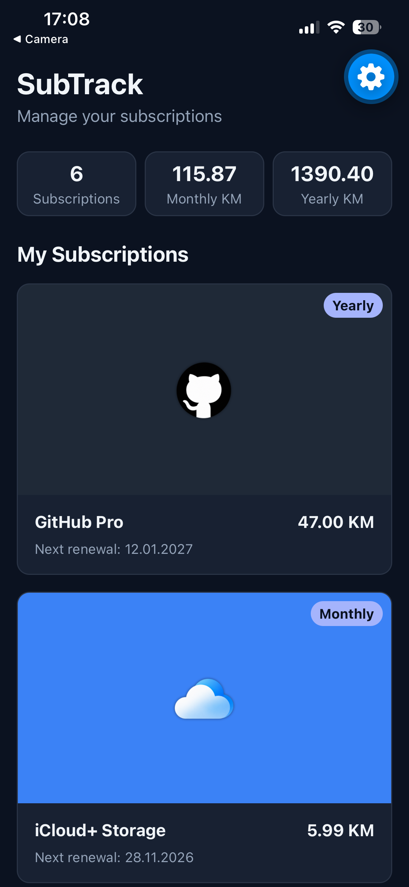

# SubTrack

SubTrack is a mobile application that helps users manage their recurring subscriptions and track monthly and yearly expenses. Users can add subscriptions, monitor upcoming renewal dates, and view their total subscription costs in one place.

## Technologies

- React Native
- Expo SDK 57
- TypeScript
- Expo Router
- Supabase (planned)

## Run the Project

1. Clone the repository.
2. Open the project folder.
3. Install dependencies:

   `npm install`

4. Start the Expo development server:

   `npx expo start`

5. Open the application using Expo Go on Android.

## Features

### Completed in Lab 4

- Expo project setup
- TypeScript subscription type
- Five mock subscriptions
- Reusable SubscriptionCard component
- Scrollable subscription list
- Reusable SubscriptionDetails component
- Press feedback and console logging

### Completed in Lab 5

- Shared light and dark theme
- Automatic theme switching based on device settings
- Safe-area support
- Responsive subscription cards
- Custom subscription logos with first-letter fallback
- Monthly and yearly billing badges
- Dynamic spending summary
- Responsive layout for phones and tablets
- Themed Subscription Details component

## Screenshots

### Light Mode

### Dark Mode

## Development Status

This project is being developed for the IT 3003 Cross-Platform Development semester assignment at International Burch University.